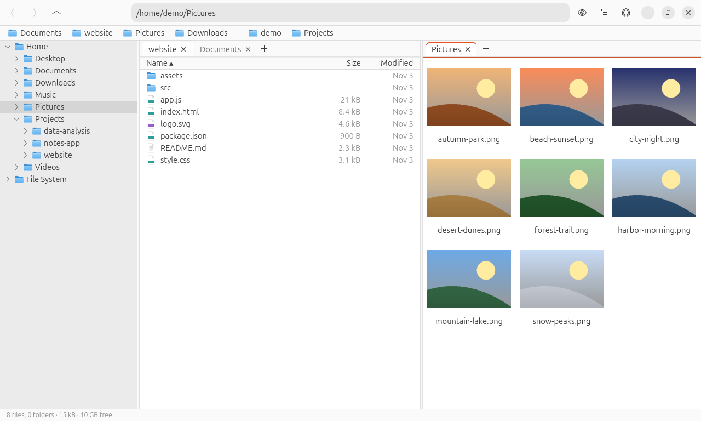
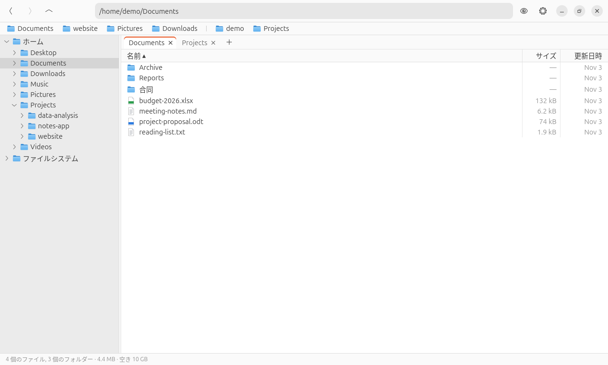
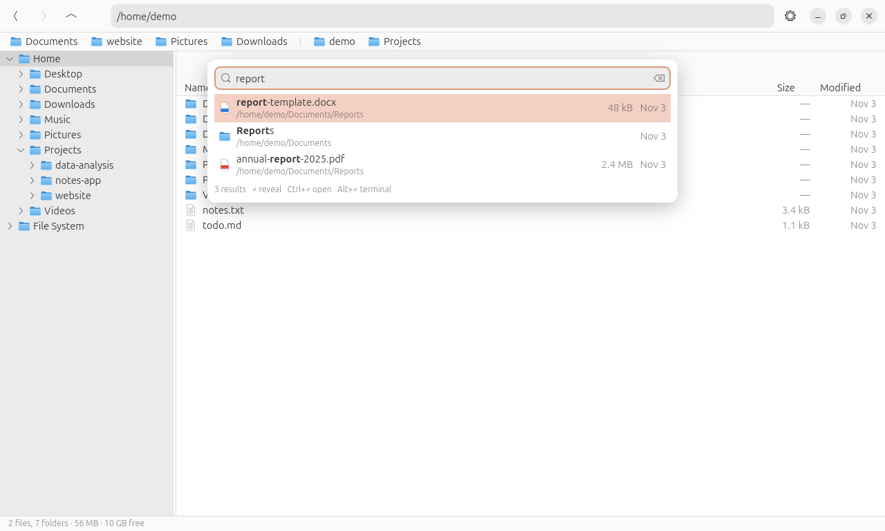
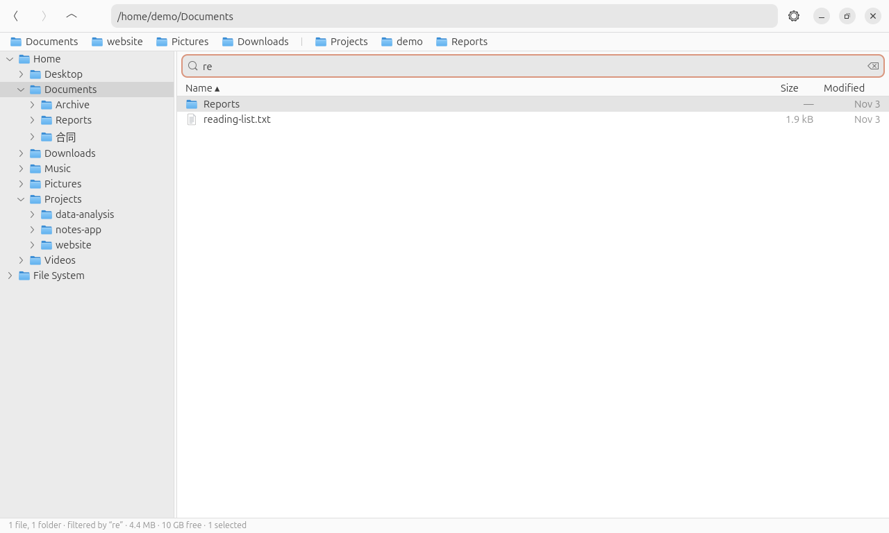
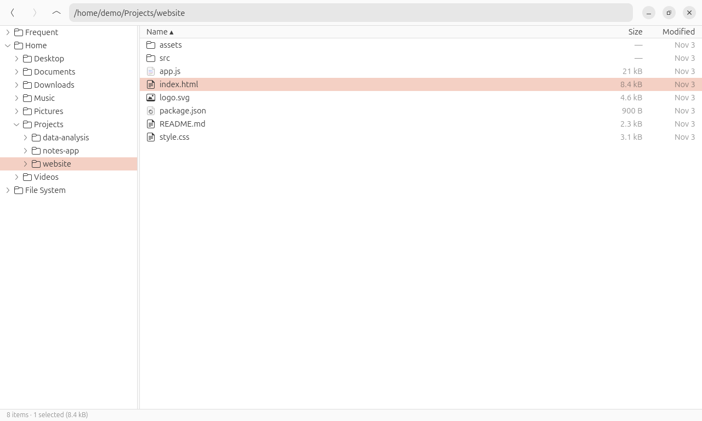

# Releases

What each release added, with screenshots of the new features. The full
list of changes is in [`CHANGELOG.md`](../CHANGELOG.md). Screenshots are
made with `scripts/screenshots.py` from a demo home folder in a sandbox,
so they show no real files.

## 0.1.2 — 2026-11-20

Tabs and a side-by-side view, thumbnails, drag and drop, resizable
columns and nine more interface languages.

- Tabs in the file list ("+" after the last tab, `Ctrl+T`, `Ctrl+W`,
  middle-click a folder); the list splits into two sides, each with its
  own tabs (`Ctrl+\`).
- Thumbnail view for folders with images (`Ctrl+2` / `Ctrl+1`).
- Drag and drop: move on the same disk, copy to another (`Ctrl` copies,
  `Shift` moves).
- Resizable columns (double-click fits), auto-hidden when the name needs
  the room.
- Traditional Chinese, Japanese, Korean, German, French, Spanish,
  Portuguese, Italian and Russian.

## 0.1.1 — 2026-11-20

Memory search with its index daemon, the bookmarks bar, launchers.

- Memory search (`Ctrl+P` or `/`): fragments in any order, pinyin, typos;
  about 10 ms on two million entries.
- Bookmarks bar with your bookmarks, launchers and most used folders.
- Find in the shown folder (`Ctrl+F`), `Enter` filters the list.

## 0.1.0 — 2026-11-18

First public preview: a fast two-pane browser.

- Folder tree on the left, details list on the right; 100,000-entry
  folders open in about 140 ms.
- Live updates, history, path bar, type-ahead, folder history by use.
- A resident instance: new windows in about 30 ms.

